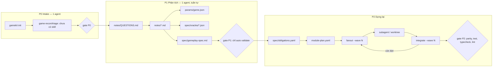
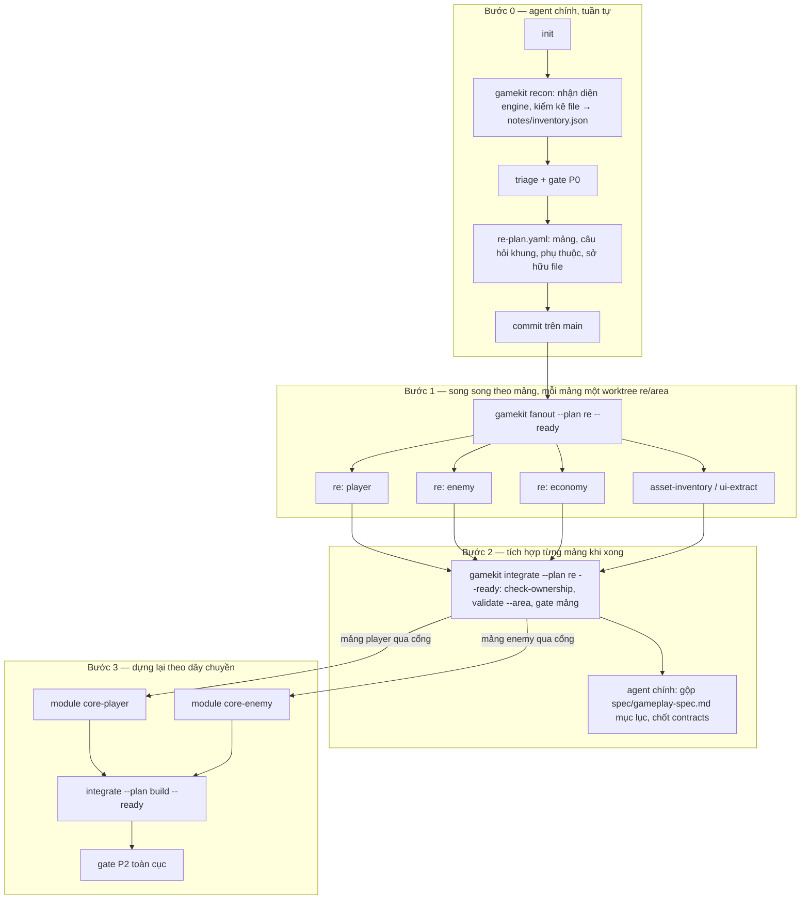

# Rà soát quy trình RE (reverse engineering) của GameKit và đề xuất quy trình song song

- Ngày: 2026-10-18 · Phiên bản plugin: 0.2.0 (commit `94ad9b8`)
- Phạm vi: chuỗi **P0 Intake → P1 Phân tích (RE) → P2 Dựng lại**, cùng các công cụ nền mà chuỗi này dùng (`game.yaml`, cổng, `validate`, `parity`, `provenance`, `precommit`, `fanout` / `check-ownership` / `integrate`, hook, skill). P3–P5 (web, SDK, đóng gói) chỉ nhắc khi liên quan.
- Hiện trạng kiểm thử: `npm test` của plugin — 73/73 test xanh (~51 s).
- Mục đích: (1) mô tả đủ chi tiết từng tính năng để **viết lại được** khi cần; (2) chỉ ra chỗ chưa tối ưu; (3) đề xuất quy trình RE **chạy song song được**, kèm kế hoạch code.

---

## 1. Tóm tắt

**Kết luận: quy trình RE chưa tối ưu và chưa song song được.** Phần dựng lại (P2) đã có hạ tầng song song khá chắc (worktree, sở hữu thư mục, merge theo phụ thuộc, hoàn tác khi test đỏ). Còn phần RE (P0–P1) gần như hoàn toàn là văn bản hướng dẫn cho **một agent làm tuần tự**:

| # | Vấn đề chính | Hậu quả |
| --- | --- | --- |
| 1 | P1 không có đơn vị công việc: không chia "mảng" (area), không có kế hoạch RE, `fanout` chỉ dùng được cho `module-plan.yaml` của P2 | Không giao RE cho nhiều agent được |
| 2 | `notes/QUESTIONS.md` là bảng Markdown, script không đọc được; cổng P1 không chấm câu hỏi | Không biết mảng nào xong, không tự động hoá được cổng P1 |
| 3 | Đầu ra RE ghi vào file dùng chung: `params/game.json` (một file), `spec/gameplay-spec.md` (một file), `QUESTIONS.md` (một file) | Nhiều agent ghi cùng file → xung đột merge |
| 4 | Worktree chỉ symlink `node_modules`; `decompiled/`, `reference/` (gitignored) **không có** trong worktree | Subagent trong worktree không thấy code decompile / asset gốc |
| 5 | Pha là toàn cục (`game.yaml: phase`): P2 chỉ bắt đầu khi **mọi** câu P1 xong | Không chạy kiểu dây chuyền (mảng A đã RE xong thì dựng A trong khi RE mảng B) |
| 6 | Không có liên kết máy đọc được câu hỏi → ghi chú → params → nghĩa vụ → module → test | Mất dấu vết; không lập brief tự động; không biết thay đổi RE ảnh hưởng module nào |
| 7 | Song song ở P2 theo **đợt** (barrier) chứ không theo đồ thị phụ thuộc; `maxParallel` chỉ cảnh báo; `integrate` dừng cả đợt ở module đỏ đầu tiên | Lãng phí thời gian chờ |
| 8 | Cổng P2 chạy vitest **hai lần** (`parity` + `test`), các kiểm tra tự động chạy nối tiếp | Cổng chậm gấp ~2 lần cần thiết |
| 9 | 6/7 skill của P0–P1 chưa có (`game-recon`, `triage`, `engine-*`, `gameplay-spec`, `asset-inventory`, `ui-extract`); không có script nhận diện engine / kiểm kê file | Việc lặp lại, máy làm được, đang để agent làm tay |

Đề xuất ở mục 4: chia RE thành **mảng** (`re-plan.yaml`), mỗi mảng có câu hỏi, ghi chú, params, oracle, nghĩa vụ **riêng file**; dùng lại cơ chế worktree hiện có cho P1; lập lịch theo đồ thị (DAG) thay cho đợt; cho phép mảng đi tiếp sang dựng lại khi cổng **mảng** qua. Kế hoạch code ở mục 5 chia thành các gói việc làm song song được.

---

## 2. Bản đồ quy trình hiện tại



Chỉ khối P2 có song song. Toàn bộ P0–P1 là một luồng, chốt bằng một cổng toàn cục.

---

## 3. Phân tích chi tiết từng tính năng (đặc tả để viết lại)

Mỗi mục: **mục đích · đầu vào/ra · luật · chỗ yếu**. Đường dẫn tính từ gốc plugin.

### 3.1 Trạng thái game — `game.yaml`, `scripts/lib/game.mjs`, `schemas/game.schema.json`

- **Mục đích**: một file trạng thái duy nhất cho mỗi game, script đọc/ghi, sửa tay được.
- **Trường liên quan RE**: `phase` (`P0`…`P5` | `released`), `source.{ownership, engine, engineVersion, path, notes}`, `gates.<Px>.{passed, at, by}`, `timings.<Px>.{start, end}`, `budget.plannedDays.<Px>`, `release.forbiddenTerms`.
- **API**: `findGameRoot(start)` đi ngược lên tìm `game.yaml`; `requireGameRoot` ném `GkError` nếu không thấy; `loadGame`; `updateGame(root, [[path, value]…])` sửa tại chỗ, giữ comment, ép map về block style; `ownershipOf(game)` mặc định `own`; `nowIso()` bỏ mili-giây.
- **Chỗ yếu**: `phase` là **một giá trị cho cả game** → không biểu diễn được "mảng A ở P2, mảng B còn P1". `timings` chỉ theo pha nên không đo được mảng nào tốn thời gian.

### 3.2 Pha và skill — `scripts/lib/phases.mjs`

- `PHASES = [P0…P5]`, `PHASE_INFO[pha] = {name, skills[], human?, thirdParty?}`; `phaseInfo(phase, ownership)` gộp phần `thirdParty` khi `source.ownership: third-party`; `nextPhase` trả `released` sau P5.
- `AVAILABLE_SKILLS`: skill có thật trong bản này; `status` đánh dấu skill còn thiếu là "chưa có — làm theo hướng dẫn chung".
- P0: `game-recon`, `triage` (đều **chưa có**). P1: `engine-<engine>`, `re-notes` (có), `gameplay-spec`, `asset-inventory`, `ui-extract` (**chưa có**).

### 3.3 Cổng — `scripts/gate.mjs`, `templates/game/gates/P*.md`

- **Cú pháp mục**: `- [ ] text` + tuỳ chọn `{auto: X}`, `{only: own|third-party}`, hậu tố `(bạn)` (chỉ người dùng tick). CRLF được hỗ trợ; cổng rỗng là lỗi (không được qua cổng "trống").
- **Auto**: `validate` (theo stage của pha), `parity`, `field:<a.b.c>` (khác rỗng/`unknown`), `file:<đường dẫn>` (tồn tại, > 0 byte), `test` / `typecheck` / `lint` (npm script), `pack`, `release-check` (gọi lại CLI). Mục auto luôn chạy lại, bỏ qua dấu tick.
- **`--advance`**: chỉ khi mọi mục `ok`; ghi `gates.<pha>`, `timings.<pha>.end`, `phase = next`, mở `timings.<next>.start`.
- **Cổng P1 hiện tại** (`templates/game/gates/P1.md`): 8 mục, **chỉ 1 mục auto** (`validate`). "Có `spec/gameplay-spec.md`", "mọi câu trong QUESTIONS.md đã trả lời", "đã trích params có source/confidence"… đều tick tay.
- **Chỗ yếu**:
  - Mục tự động hoá được nhưng đang tick tay: `file:spec/gameplay-spec.md`, trạng thái câu hỏi, ghi chú tồn tại cho mỗi câu, "mọi module đã merge, worktree đã gỡ" (cổng P2).
  - `runAuto` chạy **nối tiếp** bằng `spawnSync`; cổng P2 chạy `parity` (vitest JSON) rồi `test` (vitest lần nữa) — `scripts/gate.mjs:55`, `scripts/gate.mjs:76`.
  - Cổng chỉ có cấp game; không có cổng cấp mảng/module.

### 3.4 Kiểm tra dữ liệu — `scripts/validate.mjs`

`validateGame(root, {stage})` chạy lần lượt; `stage` = chỉ số pha, luật "từ pha X" là **lỗi** từ X, **cảnh báo** trước X.

| Bộ kiểm | Luật | Ràng buộc theo pha |
| --- | --- | --- |
| `params/**/*.json` | Schema `params.schema.json` (nút lá có `value` + `source`; `unit`, `confidence ∈ observed/derived/inferred`, `tolerance ≥ 0`, `deviation{reason, decision D-n, approved}`); thiếu `source` luôn lỗi | Từ P2: `source: TODO…` lỗi, `inferred` thiếu `tolerance` lỗi, `deviation` chưa duyệt lỗi. `deviation.decision` phải có trong `DECISIONS.md` (tiêu đề `## D-n`, bỏ qua khối code mẫu) |
| `spec/obligations.yaml` | Schema; id duy nhất; `params[]` phải có trong params (khoá `a.b` hoặc `<file>.a.b`); `oracle` phải tồn tại; `blocked/out-of-scope` cần `decision` có thật | Từ P2: waiver chưa `approved` là lỗi |
| `spec/oracles/*.json` | Schema: `source`, `cases[{in, out, tolerance?, note?}]` ≥ 1, `confidence`, `tolerance` | — |
| `portalSettings`, `Language/`, `public/Icons` | (P3–P5, ngoài phạm vi RE) | P4 |
| `provenance.json` | Schema; không trùng path; mọi file trong `assets/`, `public/` có nhãn; `FORBIDDEN_DIRS` (`reference`, `decompiled`, `builds`, `.gamekit/ghidra`, `.gamekit/local`) phải được gitignore | Từ P3: `reference` lỗi; P5: `placeholder` lỗi |
| `module-plan.yaml` | `checkModulePlan`: schema; id duy nhất; `dependsOn` tồn tại và ở **đợt trước**; `owns` không đè `shared`; hai module không cùng sở hữu một đường dẫn (`overlaps` = tiền tố thư mục) | — |
| `asset-manifest.json` | Kích thước PNG khớp spec, alpha | — |

- **Chỗ yếu với RE**:
  - **Không kiểm gì trong `notes/`**: không kiểm `QUESTIONS.md`, không kiểm ghi chú có đủ 5 phần (Kết luận / Vị trí / Độ tin cậy / Phạm vi đã tìm / Còn chưa biết), không kiểm `obligations[].source` trỏ tới file có thật.
  - **Trùng khoá params giữa nhiều file không bị bắt** (`scripts/validate.mjs:87` chỉ `keys.add`). Khi tách params theo mảng, hai agent có thể định nghĩa cùng `player.speed`.
  - `params.source` là chuỗi tự do — không liên kết được ngược tới câu hỏi/ghi chú.
  - Oracle không có trường `question`/`area`, không kiểm `confidence: derived` đi kèm cảnh báo "tự sinh oracle từ công thức mình suy ra".

### 3.5 Parity — `scripts/parity.mjs`, skill `parity-check`

- **Mục đích**: chứng minh bản web tái hiện game gốc bằng danh sách nghĩa vụ, chấm **fail-closed**.
- **Thẻ test**: `[id:case]` trong `fullName` của vitest (it hoặc describe), regex `/\[([a-z0-9][a-z0-9._-]*):([a-z-]+)\]/g`; `case ∈ normal, edge, invalid, oracle, replay`.
- **Trạng thái nghĩa vụ** (`evaluateParity`): `waived` (status khác `active`; cần D-n có thật và `approved`, nếu không thì thêm lỗi) → `failed` (có test đỏ) → `unknown` (có test skip/todo/pending) → `open` (thiếu case) → `closed`.
- **Lỗi toàn cục**: thẻ trỏ tới id không tồn tại; loại case lạ; không có nghĩa vụ bắt buộc nào (parity "rỗng" không được tính là đạt).
- **Chạy**: xoá `.gamekit/local/parity-report.json`, chạy `node node_modules/vitest/vitest.mjs run --reporter=json --outputFile=…` (không qua shell), đọc báo cáo; `--report file.json` để chấm báo cáo có sẵn.
- **Chỗ yếu**: luôn chạy **toàn bộ** vitest; không lọc theo mảng/module (`--area`, `--module`, `--obligation`); không xuất JSON kết quả cho script khác (vd. `integrate` muốn biết module vừa merge đóng được nghĩa vụ nào). Bước "phá thử để chứng minh test bắt lỗi" (mục 5 skill) là tay — có thể tự động (mutation trên `params/`).

### 3.6 Nguồn gốc asset và chặn commit — `scripts/provenance.mjs`, `scripts/precommit.mjs`

- `provenance add <file|thư mục…> --label <reference|generated|own|licensed|placeholder> [--source] [--license] [--note]`: duyệt thư mục, ghi đè theo path, sắp xếp, kiểm schema. `provenance list [--label]`.
- `precommit` (hook `.githooks/pre-commit`, `core.hooksPath`): đọc file staged (`-z`, giữ tên tiếng Việt), đọc `provenance.json` **bản staged**; chặn file trong `FORBIDDEN_DIRS`, file trông như decompile (`.il`, `*.decompiled`, `Assembly-CSharp.cs`, `dump.cs`), asset chưa nhãn hoặc nhãn `reference` trong `assets/`/`public/`; kiểm schema `game.yaml` nếu staged.
- **Chỗ yếu với RE song song**: `provenance.json` là **một file dùng chung** → nhiều agent `provenance add` cùng lúc sẽ xung đột merge (mảng asset-inventory chạy song song với mảng khác). Nhận diện code decompile chỉ theo tên file — một file `notes/x.md` dán nguyên pseudocode vẫn qua.

### 3.7 Dựng song song — `scripts/parallel.mjs`, skill `module-plan`, `integrate`

- **`module-plan.yaml`**: `base`, `shared[]`, `maxParallel` (1–8), `modules[{id, wave, owns[], dependsOn[], brief, contracts[], tests[]}]`.
- **`fanout --wave N [--dry-run]`**: phải ở `base`, tree sạch; mọi `dependsOn` của **mọi** module trong đợt đã merge (`isMerged` = có merge commit `merge: <id> (` trên base — vẫn đúng sau khi xoá nhánh); với từng module: `git worktree add ../<game>.worktrees/<id>` trên nhánh `mod/<id>`, ghi `.gamekit/local/BRIEF.md` (`briefFor`), chép `.gamekit/local/config.json`, symlink `node_modules` (junction trên Windows); in prompt giao việc.
- **`check-ownership [--module id] [--branch b]`**: file đổi = `git diff --name-only --no-renames -z base...ref` (+ working tree khi kiểm nhánh hiện tại, gồm cả nguồn của rename/copy), bỏ `.gamekit/local/`; lỗi nếu đụng `shared` hoặc nằm ngoài `owns`. Ở nhánh không phải `mod/*` thì không giới hạn.
- **`integrate --wave N [--test cmd] [--cleanup] [--dry-run]`**: ở `base`, tree sạch; thứ tự `topo()` trong đợt (phát hiện vòng); bỏ qua module đã merge; chặn worktree bẩn, nhánh không có commit, vi phạm sở hữu; `merge --no-ff -m "merge: <id> (đợt N)"`; xung đột → `merge --abort` và dừng; sau merge chạy test, đỏ → `reset --hard` về trước merge và **dừng**; `--cleanup` gỡ worktree đã merge và sạch (xoá symlink `node_modules`, `.gamekit/local`).
- **Chỗ yếu**:
  1. **Lập lịch theo đợt**: `fanout` mở cả đợt một lúc và từ chối nếu một phụ thuộc bất kỳ chưa merge (`scripts/parallel.mjs:93`). Module của đợt 2 chỉ phụ thuộc module A phải chờ cả module B (không liên quan) của đợt 1.
  2. `maxParallel` chỉ cảnh báo (`scripts/parallel.mjs:96-97`), không chia lượt.
  3. `integrate` dừng ở module đỏ đầu tiên (`scripts/parallel.mjs:212`) — các module độc lập phía sau không được merge.
  4. Mỗi lần merge chạy **toàn bộ** test; với n module là n lần chạy toàn bộ.
  5. Chỉ symlink `node_modules` (`scripts/parallel.mjs:118`) — `decompiled/`, `reference/`, `.gamekit/ghidra/` không có trong worktree.
  6. Brief chỉ gồm `brief` tự do + danh sách đường dẫn; không tự kèm nghĩa vụ, params, ghi chú, oracle liên quan.
  7. Chỉ phục vụ P2 (`module-plan.yaml`, nhánh `mod/*`, câu "skill module-plan"); P1 không dùng được.

### 3.8 `status` / `next`, hook SessionStart, lệnh `/gamekit:*`

- `status` (`scripts/status.mjs`): tên, version, engine, ownership; pha, số ngày ở pha (so `budget.plannedDays`, cảnh báo "luật cắt lỗ"); mục cổng **không auto, chưa tick**; thông tin portal thiếu; skill của pha (đánh dấu skill chưa có).
- `hooks/session-start.mjs`: cài dependency plugin lần đầu; trong thư mục game: nạp nội dung `using-gamekit` + kết quả `status` làm `additionalContext`.
- `/gamekit:next`: chạy status, chọn mục mở đầu tiên agent được làm, dùng skill tương ứng, chạy `gate`.
- **Chỗ yếu**: không có "việc nào **đang sẵn sàng** chạy song song" — chỉ có danh sách mục cổng. `next` chọn **một** việc.

### 3.9 Skill RE — `skills/re-notes/SKILL.md`

Nội dung đã tốt (đây là phần "tri thức" đáng giữ khi viết lại):
1. **Câu hỏi trước, công cụ sau**: mỗi câu ghi loại bằng chứng cần; trạng thái `mở / một phần / đã trả lời`; xem lại `notes/`, `params/` trước khi phân tích lại.
2. **Bảng nhận diện target** theo engine (Unity Mono / IL2CPP / WebGL, HTML5-Cocos-Construct-Laya, Godot, Flash, Unreal, native) và APK (`lib/*/libunity.so`, `libil2cpp.so`, `libcocos2djs.so`, `libgodot_android.so`).
3. Dùng MCP RE nếu có (tóm tắt trước, đào sâu khi có câu hỏi cụ thể, không chạy lại phân tích y hệt).
4. **Không tin decompiler một mình**: chữ ký hàm sai, đọc hằng float tại địa chỉ, đơn vị theo frame, fixed-point/chia nguyên/tràn số, RNG và cách seed.
5. **Ghi kết luận** 5 phần; số vào `params/` (`source`, `confidence`, `tolerance` cho `inferred`); bảng nhiều điểm vào `spec/oracles/`.
6. **Đóng pha**: duyệt `QUESTIONS.md`, viết `spec/gameplay-spec.md`, `validate`, `gate`.

**Chỗ yếu**: toàn bộ là văn bản; không có định dạng máy đọc cho câu hỏi và ghi chú; bước "nhận diện engine" có thể làm bằng script; bước "không chạy lại phân tích" không có nơi lưu phân tích đã chạy; `gameplay-spec.md` viết **sau** khi mọi ghi chú xong (nút thắt tuần tự).

### 3.10 Template game — phần nhận đầu ra RE

- `params/game.json` (một file) → `src/core/params.ts` **chỉ import `params/game.json`** (`templates/game/src/core/params.ts:1`). `validate` chấp nhận nhiều file `params/**/*.json` nhưng code game không đọc file thứ hai → tách params theo mảng hiện **không dùng được** trong game.
- `spec/obligations.yaml` một file; `spec/oracles/*.json` nhiều file (đã tách được).
- `notes/QUESTIONS.md` bảng một file; `DECISIONS.md` một file, đánh số `D-n` tăng dần (nhiều agent cùng thêm D-n → trùng số).
- `src/contracts/` (shared), `src/core/` (deterministic, ESLint chặn DOM, `Math.random`, `Date.now`, số lạ), test parity mẫu `tests/core/world.test.ts` đọc `raw` params để lấy `tolerance`, replay test so `worldHash`.

---

## 4. Quy trình RE đề xuất: chia mảng, chạy song song

### 4.1 Nguyên tắc

1. **Đơn vị công việc là mảng (area)**, không phải pha. Mảng = một cụm cơ chế người chơi cảm nhận được (vd. `player`, `enemy`, `economy`, `level-gen`, `ui`, `audio`, `save`). Mảng của P1 nên **trùng** module của P2 để dây chuyền liền mạch.
2. **Mỗi mảng ghi vào file riêng** — không ai ghi chung một file trong lúc song song. File chung chỉ agent chính sửa, sau khi gộp.
3. **Chốt trước khi chia** (giống nguyên tắc của `module-plan`): bản kiểm kê và danh sách mảng/câu hỏi do agent chính làm tuần tự và commit; chỉ sau đó mới fanout.
4. **Dây chuyền thay cho barrier**: mảng nào qua cổng mảng thì đi tiếp sang dựng lại, không chờ mảng khác. Cổng toàn cục của pha chỉ là "mọi mảng đã qua".
5. **Liên kết máy đọc được**: câu hỏi ↔ ghi chú ↔ params ↔ oracle ↔ nghĩa vụ ↔ module ↔ test. Brief, trạng thái, cổng đều sinh từ liên kết này.

### 4.2 Luồng mới



Trong khi mảng `economy` còn RE, module `core-player` đã có thể dựng — đó là chỗ tiết kiệm thời gian chính.

### 4.3 Bố cục file theo mảng (không ai ghi chung)

| Đầu ra | Hiện tại | Đề xuất | Chủ |
| --- | --- | --- | --- |
| Câu hỏi | `notes/QUESTIONS.md` (bảng) | `notes/<area>/questions.yaml` (schema mới) | mảng |
| Ghi chú | `notes/<chủ đề>.md` | `notes/<area>/*.md` (frontmatter: `questions: [..]`, `confidence`) | mảng |
| Số liệu | `params/game.json` | `params/<area>.json` — `params.ts` gộp mọi file (`import.meta.glob`), khoá gốc là tên file | mảng |
| Oracle | `spec/oracles/*.json` | `spec/oracles/<area>/*.json` (+ trường `area`, `question`) | mảng |
| Nghĩa vụ | `spec/obligations.yaml` | `spec/obligations/<area>.yaml` — `loadObligations` gộp; giữ đọc file cũ | mảng |
| Spec | `spec/gameplay-spec.md` | `spec/<area>.md` + `spec/gameplay-spec.md` chỉ là mục lục/core loop | mảng / chính |
| Quyết định | `DECISIONS.md`, `D-n` tăng dần | **Đã chốt và đã làm (cách 2)**: mảng ghi vào `notes/<area>/decisions.md` với mã cố định `D-<area>-n`; `DECISIONS.md` (`D-n`) chỉ agent chính sửa. `validate` chặn mã trùng và mã sai mảng | mảng |
| Provenance | `provenance.json` | `provenance/<area>.json` gộp khi đọc (hoặc chỉ agent chính `provenance add` sau integrate) | mảng |
| Kiểm kê | — | `notes/inventory.json` (do `recon` sinh) | chính |
| Contracts | `src/contracts/` | giữ: shared, chỉ agent chính | chính |

Tách file theo mảng là điều kiện **bắt buộc** cho song song; mọi thứ khác là tối ưu thêm.

### 4.4 Schema mới

**`re-plan.yaml`** (hoặc mở rộng `module-plan.yaml` thêm `kind: re | build`; đề xuất **dùng chung một schema có `kind`** để `fanout`/`integrate` dùng lại nguyên mã):

```yaml
kind: re
base: main
maxParallel: 4
shared: [notes/inventory.json, spec/gameplay-spec.md, DECISIONS.md, src/contracts/, game.yaml, re-plan.yaml]
links:                      # tài nguyên local gitignored cần thấy trong worktree (symlink)
  - decompiled/
  - reference/
  - .gamekit/ghidra/
areas:
  - id: player
    owns: [notes/player/, params/player.json, spec/oracles/player/, spec/obligations/player.yaml, spec/player.md]
    dependsOn: []           # theo DAG, không theo đợt
    targets: [Assembly-CSharp.dll:PlayerController, Assembly-CSharp.dll:PlayerStats]
    brief: Di chuyển, nhảy, va chạm của nhân vật
    buildModule: core-player   # module P2 nhận đầu ra của mảng này
  - id: economy
    owns: [notes/economy/, params/economy.json, spec/oracles/economy/, spec/obligations/economy.yaml, spec/economy.md]
    dependsOn: [player]     # cần đơn vị/điểm số từ player
    brief: Tiền, giá, phần thưởng theo level
```

**`notes/<area>/questions.yaml`**:

```yaml
questions:
  - id: player.q1
    question: Tốc độ chạy bao nhiêu, theo frame hay theo giây?
    evidence: hằng số + hàm cập nhật vị trí
    required: true
    status: answered          # open | partial | answered
    notes: [notes/player/movement.md]
    params: [player.speed]
    obligations: [player.move]
    openReason: null          # bắt buộc khi đóng mảng mà status ≠ answered
    impact: null
```

Ghi chú `notes/<area>/*.md` có frontmatter `questions`, `confidence`, `searched` (phạm vi đã tìm), `unknown` — để `validate` kiểm đủ 5 phần.

### 4.5 Cổng mảng (thay cho tick tay ở P1)

`gamekit gate --area <id>` (auto, không tick tay), qua khi:

1. `validate --area <id>`: schema questions/params/oracles/obligations; không trùng khoá params với mảng khác; mọi `params[]`, `obligations[]`, `notes[]` của câu hỏi tồn tại.
2. Mọi câu `required` là `answered`, hoặc có `openReason` + `impact`.
3. Mỗi câu `answered` có ít nhất một ghi chú; ghi chú có đủ phần bắt buộc.
4. Mỗi nghĩa vụ của mảng có `source` trỏ tới ghi chú có thật.
5. `params/<area>.json` không còn `TODO` (đây chính là luật P2 hiện tại, kéo sớm về cổng mảng).
6. `check-ownership` của nhánh `re/<area>` đạt.

Cổng P1 toàn cục thêm `{auto: areas}` = mọi mảng của `re-plan.yaml` đã qua cổng mảng (ghi `areas.<id>.passed` vào `game.yaml`, hoặc suy ra từ merge commit như `isMerged`).

### 4.6 Tối ưu lập lịch và tích hợp (dùng chung cho P1 và P2)

| Thay đổi | Chi tiết |
| --- | --- |
| `fanout --ready` | Mở worktree cho **mọi** đơn vị có `dependsOn` đã merge và chưa có worktree, tối đa `maxParallel` worktree đang mở. Giữ `--wave N` để tương thích. `wave` trở thành tuỳ chọn (suy ra từ DAG) |
| `integrate --ready [--keep-going]` | Merge mọi đơn vị đã commit, sạch; đơn vị đỏ thì hoàn tác và **bỏ qua cả nhánh con phụ thuộc nó**, tiếp tục đơn vị độc lập; cuối cùng in bảng: merged / đỏ / chưa xong / bị chặn |
| Test sau merge theo phạm vi | `--test` mặc định = test của đơn vị (`tests[]`) + `parity --area/--module`; chạy toàn bộ một lần ở cuối đợt tích hợp. Giảm từ n lần toàn bộ xuống n lần cục bộ + 1 lần toàn bộ |
| `links:` trong plan | `fanout` symlink `decompiled/`, `reference/`, `.gamekit/ghidra/` (vốn gitignored) vào worktree, giống `node_modules`; `cleanup` gỡ symlink trước `worktree remove` |
| Brief sinh từ liên kết | `briefFor` kèm: câu hỏi của mảng (P1), hoặc nghĩa vụ + case + params + oracle + ghi chú nguồn của module (P2); target trong `inventory.json` |
| `maxParallel` thật | Chia lượt thay vì chỉ cảnh báo |
| Tiền tố nhánh | `re/<id>` cho P1, `mod/<id>` cho P2 (merge message `merge: <kind>/<id>`), để `isMerged` không lẫn |
| `status --parallel` / `next` | Liệt kê đơn vị **sẵn sàng**, đang chạy (worktree tồn tại, số commit), xong chờ integrate, bị chặn (do phụ thuộc nào) — để agent chính giao nhiều việc trong một lượt |

### 4.7 Tự động hoá phần máy làm được

| Lệnh mới | Việc | Thay cho |
| --- | --- | --- |
| `gamekit recon <đường dẫn game gốc>` | Nhận diện engine theo dấu hiệu file (bảng ở mục 3.9: `*_Data/Managed/Assembly-CSharp.dll`, `GameAssembly.dll` + `global-metadata.dat`, `Build/*.wasm`, `.pck`, `.swf`, `.pak`, `lib/*/libunity.so`…); kiểm kê (đường dẫn, cỡ, sha256, loại: code/data/asset/khác); ghi `notes/inventory.json`, điền `source.engine`, `source.path` | skill `game-recon` (chưa có), mục cổng P0 tick tay |
| `gamekit re-plan --suggest` | Từ `inventory.json` đề xuất mảng ban đầu (vd. theo namespace/class của assembly, theo thư mục asset) — agent chính sửa lại | lập kế hoạch tay |
| `gamekit questions [--area] [--json]` | Bảng câu hỏi theo trạng thái, tỉ lệ đóng mỗi mảng; dùng trong `status` | đọc bảng tay |
| `gamekit parity --area/--module/--json` | Chấm một phần; JSON cho `integrate`/`gate` | chạy toàn bộ |
| `gamekit parity --mutate` | Với mỗi nghĩa vụ có `params`, đổi từng giá trị (vd. ×1.5), chạy test liên quan, nghĩa vụ phải chuyển `failed`; hoàn tác | bước "phá thử" tay ở skill parity-check |
| Cổng chạy song song | `runAuto` bằng `spawn` bất đồng bộ cho `typecheck`, `lint`; `test` và `parity` dùng **chung một** lần chạy vitest JSON (`test` đọc kết quả từ báo cáo parity) | 2 lần vitest, chạy nối tiếp |

---

## 5. Kế hoạch code (chia gói làm song song được)

Thứ tự phụ thuộc: **W0** phải xong trước; các gói trong cùng một lớp làm song song được (file sở hữu không giao nhau).

| Gói | Lớp | Sở hữu (file) | Việc | Test (`tests/cli.test.mjs` hoặc file test riêng) |
| --- | --- | --- | --- | --- |
| **W0 Lược đồ chung** | 0 | `schemas/questions.schema.json` (mới), `schemas/module-plan.schema.json` (thêm `kind`, `links`, `areas`/`modules`, `wave` tuỳ chọn), `scripts/lib/plan.mjs` (mới: `loadPlan(root, kind)`, `units()`, `readySet()`, `branchOf(kind,id)`) | Chốt định dạng; giữ tương thích `module-plan.yaml` cũ | plan cũ vẫn hợp lệ; DAG vòng bị chặn; `readySet` đúng |
| **W1 Params/obligations nhiều file** | 1 | `scripts/validate.mjs` (params, obligations), `templates/game/src/core/params.ts`, `templates/game/spec/` | `loadObligations` gộp `spec/obligations.yaml` + `spec/obligations/*.yaml`; báo trùng khoá params giữa file; `params.ts` gộp `import.meta.glob('../../params/*.json', {eager:true})` theo tên file (giữ `game.json` gộp ở gốc để tương thích) | trùng khoá lỗi; game thử: test/typecheck/lint/pack xanh |
| **W2 Câu hỏi & ghi chú** (mã quyết định theo mảng đã xong, xem 5.0) | 1 | `scripts/questions.mjs` (mới), `scripts/validate.mjs` (phần notes — tách thành `scripts/lib/validate-notes.mjs` để không đụng W1), `templates/game/notes/` | Đọc `notes/**/questions.yaml` (và cảnh báo nếu còn `QUESTIONS.md` kiểu cũ); kiểm liên kết; kiểm frontmatter ghi chú; lệnh `questions` | câu `answered` không có ghi chú → lỗi; `openReason` bắt buộc khi đóng |
| **W3 Lập lịch song song** | 1 | `scripts/parallel.mjs` | `fanout/integrate --plan re|build --ready`, `--keep-going`, `links:` symlink, chia lượt `maxParallel`, tiền tố nhánh theo kind, brief giàu thông tin | worktree có symlink `decompiled/`; nhánh đỏ không chặn nhánh độc lập; con của nhánh đỏ bị bỏ qua |
| **W4 Recon** | 1 | `scripts/recon.mjs` (mới), `schemas/inventory.schema.json` | Nhận diện engine, kiểm kê, ghi `notes/inventory.json`, điền `game.yaml` | thư mục giả cho từng engine (Unity Mono, IL2CPP, WebGL, Godot, APK) |
| **W5 Cổng** | 2 (sau W2, W3) | `scripts/gate.mjs`, `templates/game/gates/P1.md`, `P2.md` | `gate --area`; auto `areas`, `questions`, `file:spec/gameplay-spec.md`, `merged` (mọi module đã merge + worktree gỡ); chạy auto song song; dùng chung một lần vitest | cổng mảng qua/không qua; P2 chạy vitest đúng 1 lần |
| **W6 Parity một phần** | 2 (sau W1) | `scripts/parity.mjs` | `--area`, `--module`, `--json`, `--mutate` | lọc đúng; mutate làm nghĩa vụ đỏ |
| **W7 Status/next** | 2 (sau W3) | `scripts/status.mjs`, `commands/next.md` | Đơn vị sẵn sàng / đang chạy / chờ integrate / bị chặn; `next` gợi ý giao **nhiều** việc một lượt | output có các nhóm |
| **W8 Skill** | 3 | `skills/re-plan/` (mới), `skills/re-notes/`, `skills/game-recon/` (mới), `skills/module-plan/`, `skills/integrate/`, `skills/using-gamekit/`, `scripts/lib/phases.mjs` (`AVAILABLE_SKILLS`), `README.md`, `CHANGELOG.md` | Viết theo luồng mới; nêu cách giao song song (Claude Code: nhiều Agent trong một lượt; Codex: mỗi worktree một session) | `tests/skills.test.mjs` (frontmatter) |

Theo `AGENTS.md`: mỗi lệnh mới thêm vào `COMMANDS` + `HELP` trong `scripts/gamekit.mjs` và có test trong `tests/cli.test.mjs`; sửa template thì tạo game thử và chạy test / typecheck / lint / pack / release-check của nó; `npm test` trước khi commit.

### 5.0 Đã làm: mã quyết định theo mảng

- Mã hợp lệ: `D-n` hoặc `D-<mảng>-n` (`<mảng>` theo dạng id module: `[a-z0-9][a-z0-9-]*`) — `schemas/params.schema.json`, `schemas/obligations.schema.json`, `DECISION_ID` trong `scripts/validate.mjs`.
- Nguồn: `DECISIONS.md` + mọi `notes/<mảng>/decisions.md` (`decisionEntries`); `params.deviation.decision` và `obligations[].decision` tra trong cả hai.
- `validate`: mã trùng (cùng file hay khác file) là lỗi; trong `notes/<mảng>/decisions.md` chỉ được dùng `D-<mảng>-n` của chính mảng đó.
- Agent chính vẫn có thể chuyển một quyết định sang `DECISIONS.md` mà giữ nguyên mã.

### 5.1 Tương thích ngược

- `module-plan.yaml` không có `kind` = `build`; `wave` vẫn được tôn trọng khi có.
- `spec/obligations.yaml`, `params/game.json`, `notes/QUESTIONS.md` kiểu cũ vẫn đọc được; `validate` chỉ cảnh báo, gợi ý tách theo mảng.
- Game nhỏ: không có `re-plan.yaml` = một mảng ngầm định `main`, cổng P1 chạy như cũ cộng các auto mới. Ghi lý do không chia vào `DECISIONS.md` như luật hiện tại của `module-plan`.

### 5.2 Rủi ro cần để ý

- **Contract trôi**: mảng RE song song có thể dùng đơn vị khác nhau (px/frame vs px/s). Giảm bằng: `re-plan.yaml` chốt đơn vị chuẩn và `fixedStepHz` từ bước 0; `validate` bắt `unit` khác nhau cho cùng tên tham số ở các mảng.
- **Oracle tự sinh**: oracle `derived` do chính agent của mảng suy ra rồi dùng để test chính code của mình — giữ cảnh báo của skill parity-check; nên để agent **khác** (mảng khác hoặc agent chính) review oracle `derived` trước khi cổng mảng qua.
- **Luật third-party**: symlink `reference/`, `decompiled/` vào worktree không làm chúng bị commit (vẫn gitignored, `precommit` vẫn chặn), nhưng `check-ownership` cần bỏ qua đường dẫn symlink; luật "chỉ phân tích tĩnh" áp cho mọi subagent — đưa vào brief.
- **`DECISIONS.md` đánh số**: đã chốt mã `D-<mảng>-n` (xem 4.3, mục 5.0).

---

## 6. Phụ lục — thông tin tham chiếu nhanh

- Thẻ test parity: `[id:case]`, case `normal | edge | invalid | oracle | replay`.
- Trạng thái parity: `closed | open | failed | unknown | waived`; chỉ `closed` tính là đã kiểm chứng.
- `confidence`: `observed` (đọc thẳng) · `derived` (suy từ logic) · `inferred` (ước lượng, cần `tolerance` từ P2).
- Nhãn provenance: `reference | generated | own | licensed | placeholder`; `reference` bị chặn từ P3, `placeholder` từ P5.
- Thư mục cấm commit: `reference/`, `decompiled/`, `builds/`, `.gamekit/ghidra/`, `.gamekit/local/`.
- Mã thoát CLI: 0 đạt, 1 lỗi/chưa đạt, 2 lệnh không tồn tại; shim `scripts/gk.mjs` trả 3 khi không tìm thấy plugin.
